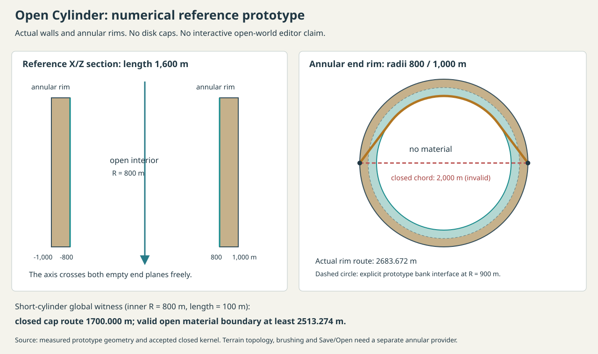

# Open Cylinder: measured assessment and numerical prototype

The authorized overnight sequence ends with a **numerical reference prototype**
for a cylinder with both ends open. The completed capped hollow-cylinder editor
and its holes, physical networks, links and v13 Save/Open remain available.
Interactive Open Cylinder creation, painting, three-view editing and Save/Open
are **not implemented**. This document does not claim basic Open Cylinder UI
feature parity or owner acceptance.

The original Pass 6 explicitly permits this outcome:

> If the current cylindrical representation cannot support this safely with small adapters, preserve the completed capped hollow cylinder and deliver a documented open-cylinder numerical design/prototype rather than forcing an unsafe implementation.

The later update requires applicable basic holes, tunnels and links now, while
preserving validation and the accepted shared infrastructure. The prototype
therefore includes their actual reference-shell geometry and identity contracts;
their operational editing/history/persistence remains future work. The measured
topology and distance incompatibilities below explain why this is the documented
fallback, rather than an additional interactive shape in the selector.



## Why the closed-cylinder adapter is insufficient

The accepted closed-cylinder kernel is correct for a wall joined to two **disk**
caps. An open thick cylinder has an outer wall, an inner wall and two **annular**
rims. Its complete material boundary connects the two banks through those rims.
Suppressing cap drawing would leave incorrect metrics and canonical data.

The reproducible [measurement receipt](evidence/open-cylinder-prototype.json)
records three concrete witnesses against that shortcut:

| Witness | Accepted closed representation | Required open representation |
| --- | --- | --- |
| Opposing midpoint wall points, radius 800 m, length 100 m | Certified global route through the start disk: 1,700.000000000364 m; lower bound 1,699.999499966444 m | Any actual open-boundary route is at least pi x 800 = 2,513.274122871835 m, attained along the inner wall |
| Opposing points at radius 1,000 m on an annulus with inner radius 800 m | Disk chord: 2,000 m | Tangents plus inner circular arc: 2,683.672348802580 m |
| Cap row zero at angular columns 0 and 8 | Both resolve to canonical sample index 144 | Opposing real inner-rim points are 1,600 m apart and need distinct data |

For the first witness, every actual open-boundary point has cylindrical radius
at least 800 m. Connecting the opposing angles requires total angular variation
at least pi, so path length is at least 800 x pi. The closed solver's upper bound
is **813.274122871471 m shorter** because its valid closed route crosses a disk
that is absent in the open geometry. This is an applicability failure, not a
defect in the closed solver. It cannot become an open brush metric by hiding caps.

There is also an orientation difference. At the positive axial end, the true
annular rim's outward-from-material normal is +Z for both ownership banks.
Reflecting an entire closed inner bank would instead give its disk a -Z normal.
An annular implementation needs patch-specific charts and seam transport.

## Delivered reference model

[`open-cylinder-prototype.ts`](../src/surfaces/open-cylinder-prototype.ts) is a
pure numerical module. It allocates no terrain authority, editor session, worker
or saved World, and is not imported into the application. Its provider is
`physical-open-cylinder-reference-prototype`, with explicit `both-open`
configuration, nested radii and one shared axial length. Its metadata version 1
is unrelated to saved-map version 1. Supported dimensions are 1..1e9 m, each
length/radius ratio 0.1..20, and radial thickness at least
max(0.001 m, outer radius x 1e-9).

The material is exactly:

```text
inner radius <= hypot(X,Y) <= outer radius
-length/2 <= Z <= length/2
```

`side` charts use axial meters and periodic angle; the inner wall reflects angle
to preserve a right-handed chart with its physical inward normal. `rim-start`
and `rim-end` use physical radial meters and their own angular orientation.
Wall/rim joins preserve physical points and expose reversible tangent transport.
The prototype exposes same-wall and same-annulus distances only. It makes no
global certified route, brush footprint or stroke-spacing claim.

The explicit experimental `midpoint-split-prototype-v1` policy assigns the outer
half of each annulus to the exterior bank and the inner half to the interior
bank. Both may address the shared mid-radius interface; the exterior is its
canonical tie owner. This is a **prototype policy**, not an adopted terrain
storage layout or a settled user-facing editing rule. A working editor must
store that interface once, share its aliases, and define cross-bank brush and
history transactions before enabling edits there. Positive heights must follow
the actual material normal on every patch, including both annular ends.

Analytic material tracing reuses the generic finite-cylinder subtraction engine
with equal outer/cavity axial bounds. That produces true annular rims and no
disk caps. Public prototype results name outer wall, inner wall, start/end rim
or cut rock. Rays originate in validated free space. The free-volume predicate
also handles the empty center at the exact open-end planes; a strict closed
cavity test would incorrectly reject that transition.

## Applicable basic physical features in the prototype

Natural axial ends require **zero authored ThroughHole objects**. Separate
radial wall holes have two independent, aligned mouth identities, adjustable
radius, identity-preserving resize/move and real material subtraction. They
must clear the actual end rims. This direct-hole prototype does not offer an
axial annulus hole; independently chosen annular openings are supported through
the physical passage graph instead.

Physical passages reuse the generic sphere/capsule graph. Entrance and exit may
be selected independently on supported wall or annular-rim positions. Whole
balls and nonportal capsules must fit in the actual annular wall material;
portal stubs follow the selected patch's physical normal. Routes stage within
material, use bounded angular subdivision, and reject invalid clearance,
subprecision radii, overlapping mouths and excessive primitives. Generic valid
branch/chamber graph structures remain representable. Independent cutters have
conservative nonoverlapping bounds; intersecting features must be one network.
The combined numerical model permits at most 48 cutting primitives and eight
networks. There is no authoring preview, confirmation, transactional journal or
guided camera connected to this prototype.

Reciprocal conceptual links preserve independent anchor identities, local and
external references and identity-preserving relocation. Physically identical
cross-bank rim aliases cannot be linked as distinct destinations. Links never
remove material. There is no Open Cylinder link UI or external map navigation.

These are reference-shell numerical capabilities. There is no sculpted terrain
protection mask or terrain-aware excavation in the prototype. Operational Sphere
and capped-cylinder editors continue enforcing protected zero-height ground.

## Work required before interactive Open Cylinder delivery

1. Add a real annular terrain provider: noncollapsed angular inner edges,
   canonical rim/wall aliases, shared bank-interface authority, physical
   neighbors and perpatch normals. Preserve all accepted closed metadata.
2. Certify global routes on this complete connected boundary, including periodic
   choices and annular obstacles. Integrate discovery, four tools, carried stroke
   spacing, connected smoothing and worker source acknowledgement without
   substituting a disk metric or a numerical sampling approximation.
3. Define atomic cross-bank writes and exact history for rim operations, display
   epochs, cut-support masks, failure/cancellation and lifetime. Keep ownership
   under the existing parent document and host.
4. Integrate fitted Inside editing, separate read-only View from inside, and an
   editable connected map in the existing Atlas chrome. Add operational hole,
   network and link controls, preview/confirmation and continuous guided travel.
5. Add a new strict persistence interpretation with exact journal validation and
   migration rules; verify both independent banks, shared seams and every prior
   format. No existing capped save may silently become an open cylinder.
6. Verify desktop and native touch/pen input, both renderers, actual cuts,
   sustained painting, exact Undo/Redo/Save/Open and rejected operations; obtain
   owner hands-on acceptance. Browser emulation cannot supply physical-device
   or human acceptance.

This is a future implementation boundary within the existing Atlas architecture.
It does not authorize pyramids, website integration, databases, full displaced
terrain, arbitrary free flight or a replacement painting engine.

## Reproduce and inspect

From the repository root with Node 24:

```powershell
node --test src/surfaces/open-cylinder-prototype.test.ts
node scripts/measure-open-cylinder-prototype.mjs .local/open-cylinder-measurement.json .local/open-cylinder-measurement.svg
npm.cmd test
npm.cmd run build
```

The eight targeted tests exercise both banks and every reference patch, tangent
orientation and reversible joins, the actual accepted kernel/storage witnesses,
both empty end planes, real wall/rim rays, hole identity edits and subtraction,
nine wall/rim portal pairings with continuous free-volume route samples,
branch containment, radius-floor rejection and reciprocal link aliases. They are
numerical tests, not interactive Open Cylinder acceptance tests.

The measurement script regenerates raw numerical observations and the diagram;
the committed receipt additionally records the final verification run. Its
`base` identifies the capped checkpoint used for the original measurement. A
rerun after commit naturally reports the newer HEAD and fresh feature UUIDs.
The source fingerprint normalizes CRLF to LF over sorted `src` paths and bytes.
Local logs are supporting workspace records; the source, compact receipt and
diagram are committed for independent reproduction.
